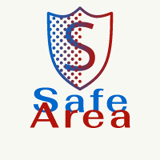

# Projet Safe Area (web)

Aujourd'hui, le nombre quantifié de plaintes, rapports et dénonciations au sujet des comportements entre collègues, ou sur le plan hiérarchique est en constante hausse. Sur l'ensemble des situations dégradantes et/ou malsaine au travail, seul une infime partie est reportée, par peur de représailles ou de non-traitement du problème.
Le projet Safe Area permet d'assurer un suivi précis et une sécurité aux salariés au sein de leur société. En cas de plainte, une trace est écrite, et si besoins, la possibilité de faire remonter les informations à la direction, DHR/RH, ou forces de l'ordre si besoins.

# Installation
- ``composer install``
- ``npm install``
- ``php artisan optimize:clear`` 
- ``php artisan migrate:fresh --seed`` 
- ``php artisan ziggy:generate`` 
- ``npm run build``

