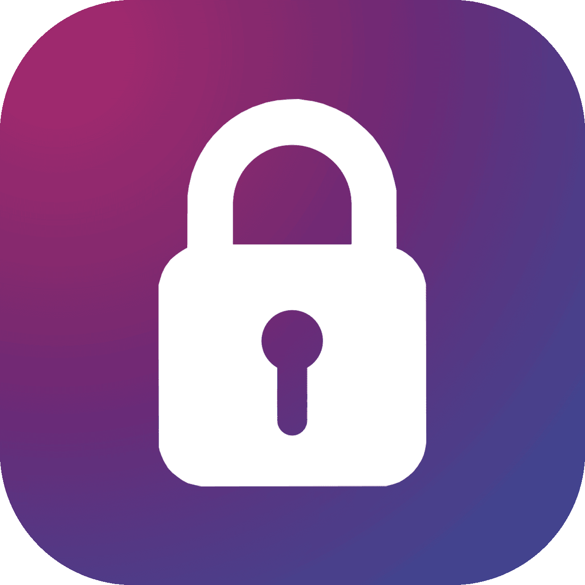

# Projet SafeArea
Stack technique [Vue 3](https://vuejs.org/), [Laravel 9](https://laravel.com/) and [Inertia.js 0.6](https://inertiajs.com/).
Vous pouvez accéder au site ici [https://safearea.fr](https://safearea.fr).

Aujourd'hui, le nombre quantifié de plaintes, rapports et dénonciations au sujet des comportements entre collègues, ou sur le plan hiérarchique est en constante hausse. Sur l'ensemble des situations dégradantes et/ou malsaine au travail, seul une infime partie est reportée, par peur de représailles ou de non-traitement du problème.
Le projet Safe Area permet d'assurer un suivi précis et une sécurité aux salariés au sein de leur société. En cas de plainte, une trace est écrite, et si besoins, la possibilité de faire remonter les informations à la direction, DHR/RH, ou forces de l'ordre si besoins.

## Installation

Vous devez d'abord installer toutes les dépendances.

- ``composer install``
- ``npm install``

Copiez ensuite le fichier '.env.example' et renommez-le en '.env', éditez-le avec vos informations.
Après, configuré la base de données (vous devez créer une base de données vide avant d'exécuter cette commande).

- ``php artisan migrate:fresh --seed`` 

Ensuite, vous devez générer le fichier de routage.

- ``php artisan ziggy:generate`` 

Enfin, créez le dossier build.

- ``npm run build``

Ouvrer [http://localhost:8000](http://localhost:8000) pour accéder au site en local.

En cas de soucis de cache
- ``php artisan optimize:clear`` 
